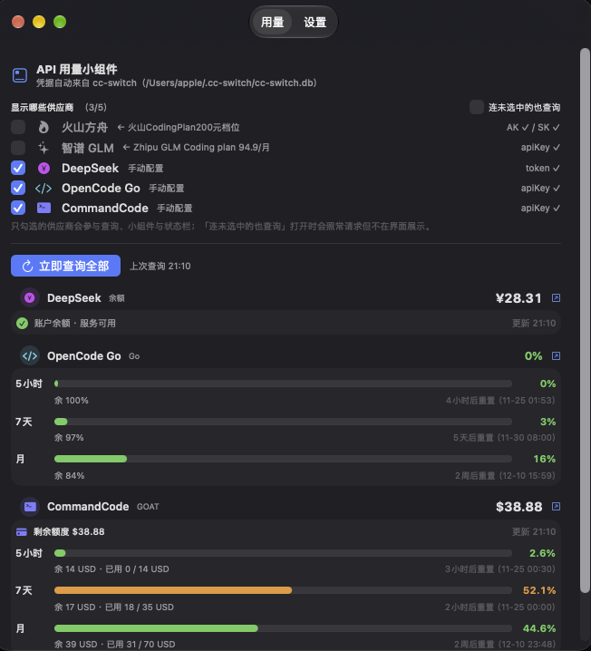
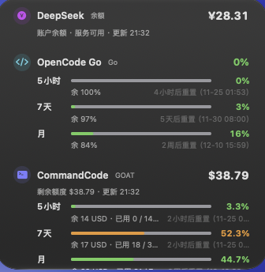
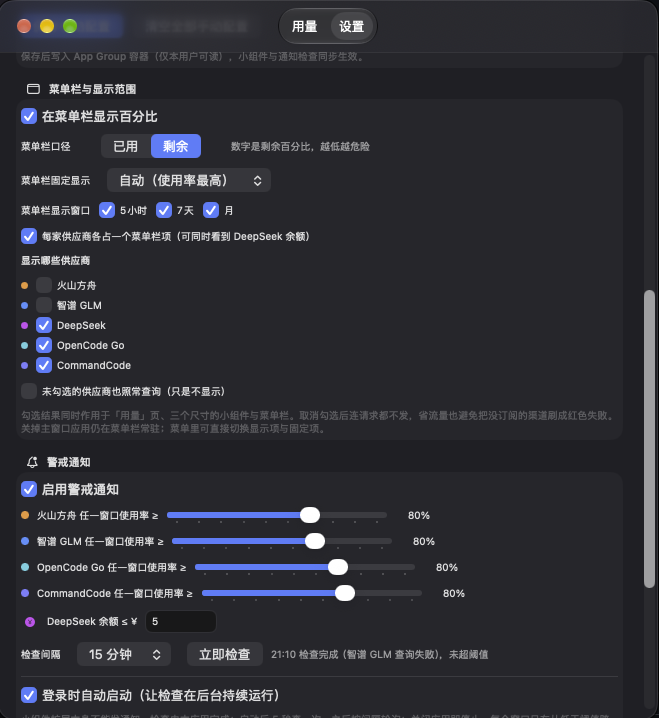
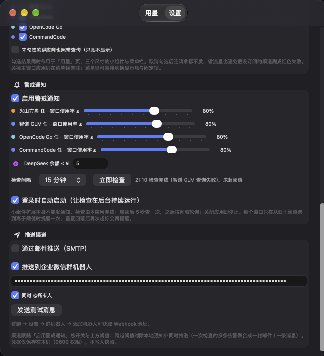
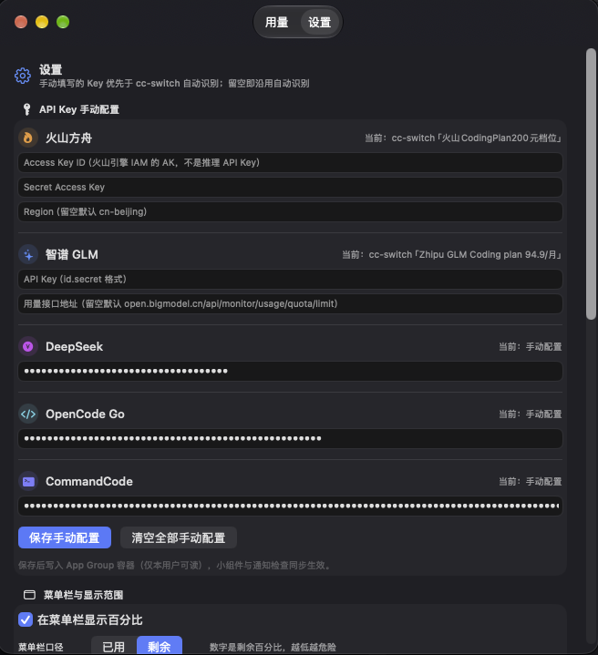

# QuotaBar · AI Subscription Quota Monitor

**English** · [简体中文](README.md)

> macOS menu bar + desktop widget + Windows CLI — see what's left on all your AI coding subscriptions at a glance.



Collects quota from Volcengine Ark, Zhipu GLM, DeepSeek, OpenCode Go and CommandCode into one place: a persistent menu bar readout, desktop widgets, and low-quota alerts. Credentials are picked up automatically from [cc-switch](https://github.com/farion1231/cc-switch) — zero configuration.

**Zero third-party dependencies.** The Swift side uses only system frameworks (SwiftUI / AppKit / WidgetKit / CryptoKit / SQLite3). The Windows side uses only the Python standard library.

---

## Supported providers

| Provider | Metrics | How it's queried |
|---|---|---|
| **Volcengine Ark** Coding Plan | 5h / 7d / monthly usage, remaining quota, reset time | OpenAPI V4 signature (AK/SK); falls back from `GetCodingPlanUsage` to `GetAFPUsage` |
| **Zhipu GLM** Coding Plan | 5h / 7d windows, remaining credits, used/total, reset time | `GET /api/monitor/usage/quota/limit` with a bare apiKey |
| **DeepSeek** | Account balance (CNY) + service availability | `GET /user/balance` |
| **OpenCode Go** | 5h / 7d / monthly usage and reset time | `GET opencode.ai/zen/go/v1/usage` with a Bearer sk- key |
| **CommandCode** (GOAT / Pro / Max…) | 5h / weekly / monthly usage + credits balance (USD) | The official CLI's private `/alpha` routes |

### A note on CommandCode's monthly math

`billing/credits` returns the **remaining** pool, not the total allotment. Monthly usage is therefore `spent ÷ (spent + remaining)` — measured on GOAT: 30.90 spent + 39.35 remaining = 70.25 total.

Treating the remaining pool as the total (`spent ÷ remaining`) badly overstates usage late in a billing period: the same numbers would read 78% instead of 44%.

---

## Three surfaces

### Menu bar

Always resident: an icon plus usage numbers, colored by utilization (<50% green / ≥50% orange / ≥80% red).


The capture above is in "remaining" mode: one menu bar item per provider — CommandCode, OpenCode Go, and DeepSeek's balance.

- **One menu bar item per provider** (default) — you can see DeepSeek's balance `¥28.31`, OpenCode Go's `5h 1% · 7d 3% · 30d 16%`, and CommandCode's `5h 0.2% · 7d 51% · 30d 44%` simultaneously
- Or merge everything into a single item that shows the highest-utilization provider
- Click the menu for per-provider detail (every window, balance, reset countdown), display toggles, refresh, and direct links to each console
- Closing the main window doesn't quit the app; the menu bar item stays

### Desktop widgets

Three sizes (small / medium / large). The system refreshes them on its ~15-minute budget; each size also has a ↻ button for a manual refresh.

<p>

</p>

The capture above is the large widget: one card per provider, stacked, with balance and every window's progress visible at a glance. Clicking a card opens that provider's console.

### Low-quota alerts

Local notifications when any window of Volcengine / Zhipu / OpenCode Go / CommandCode crosses your threshold, or when DeepSeek's balance drops below yours. Can also push to **email (SMTP)** or a **WeCom group bot**. Each window alerts once when it crosses upward — no repeat spam.

---

## Show only the providers you actually pay for

Unsubscribed services don't have to appear anywhere:

- A checkbox per provider on the Usage tab, mirrored in Settings
- The selection applies to the cards, all three widget sizes, alerts, and the menu bar
- By default **unselected providers aren't queried at all** — saves traffic and avoids painting services you don't have in red; turn on "query unselected providers too" if you want the data without the clutter
- Deselecting everything means "show all" — you can never end up with an empty state
- The menu bar has its own window filter (5h / 7d / 30d, any combination)

| Display scope & menu bar mode | Alert thresholds & push channels |
|---|---|
|  |  |

---

## How it works

```
Container app (not sandboxed)
  ├─ Reads ~/.cc-switch/cc-switch.db (read-only SQLite)
  │    Credentials discovered via meta.usage_script. OpenCode's key_env stores only
  │    a variable name — the value is resolved from a dotenv file (~/.hermes/.env etc.)
  └─ Exports credentials.json (0600) into the App Group container, then reloads widgets

Widget extension (sandboxed + network.client + App Group)
  ├─ Reads credentials.json from the App Group container
  ├─ Queries providers concurrently (CryptoKit signs Volcengine's V4 requests)
  ├─ Writes snapshot.json (the app reads the same cache on launch)
  └─ Renders; on network failure it shows cached values and says so

Menu bar (NSStatusItem inside the app process)
  └─ Renders from the same snapshot; network requests only on explicit refresh
```

**The widget must be sandboxed**: macOS's plugin registry (pkd) refuses to load an unsandboxed appex, so the widget exchanges data with the unsandboxed app through an App Group.

Credentials **stay on your machine** (App Group container, mode 0600) and never reach logs or the snapshot file.

---

## Installation

### Build from source (macOS)

```bash
# Terminal self-check: verifies credentials and parsing without the Xcode project
swiftc -O Shared/Models.swift Shared/ProvidersStore.swift Shared/QueryService.swift \
       Shared/SnapshotCache.swift scripts/UsageCheck.swift -o build/usagecheck && ./build/usagecheck

# Build the app + widget extension
DEVELOPER_DIR=/Applications/Xcode.app/Contents/Developer \
  xcodebuild -project ApiUsageShow.xcodeproj -target ApiUsageShow \
  -configuration Release SYMROOT="$PWD/build" OBJROOT="$PWD/build/obj" build

# Install and register
cp -R build/Release/ApiUsageShow.app /Applications/
open /Applications/ApiUsageShow.app
/System/Library/Frameworks/CoreServices.framework/Frameworks/LaunchServices.framework/Support/lsregister -f /Applications/ApiUsageShow.app
```

Add the widget: right-click the desktop or Notification Center → "Edit Widgets" → search "API Usage".

### Code signing (required, or the widget won't appear)

For a widget to show up in the gallery on macOS 26, both of these must hold:

1. **Signed with a development certificate** (ad-hoc `-` won't do). Xcode → Settings → Accounts, sign in with an Apple ID (a free personal team is enough), then Manage Certificates → create an Apple Development certificate. `DEVELOPMENT_TEAM` in the project must be the certificate's **real Team ID** (the `OU=` from `security find-certificate -c "Apple Development" -p | openssl x509 -noout -subject`) — the identifier in the certificate's display name can differ, and using that one gives you `No signing certificate "Mac Development" found`.
2. **The widget extension must enable App Sandbox.** `Widget/ApiUsageShowWidget.entitlements` declares `app-sandbox` + `network.client` + `application-groups`; the app itself carries only `application-groups` so it stays unsandboxed and can read the cc-switch database.

**Use your own Team ID**: this repo ships no usable signing identity. Replace three things — `DEVELOPMENT_TEAM` in `project.pbxproj`, the App Group ID in both `.entitlements` files, and the prefix of `AppGroup.identifier` in `Shared/SnapshotCache.swift`. An App Group ID must be prefixed with your own Team ID.

Confirm the extension was registered: `pluginkit -m -v -i com.apiusage.show.widget`

### Windows / WSL (CLI)

Python 3.10+, standard library only:

```bat
python windows\api_usage.py                  :: query once
python windows\api_usage.py --watch 300      :: refresh every 5 min + Windows toast on breach
python windows\api_usage.py --json           :: machine-readable output
python windows\api_usage.py --list           :: list discovered credentials (masked)
```

See [windows/README-WINDOWS.md](windows/README-WINDOWS.md). The menu bar and widgets are macOS-only; the Windows tool is a feature-equivalent CLI.

---

## Where credentials come from

**Preferred: automatic discovery via cc-switch.** Whatever you configured there is what gets used; reopen the app after changing a key.

| Provider | Source in cc-switch |
|---|---|
| Volcengine Ark | `usage_script.accessKeyId` / `secretAccessKey` (region derived from `ANTHROPIC_BASE_URL`) |
| Zhipu GLM | `usage_script.apiKey` / `baseUrl` |
| DeepSeek | `env.ANTHROPIC_AUTH_TOKEN` (base URL containing `api.deepseek.com`) |
| OpenCode Go | `api_key` → `key_env` → `options.apiKey` (`key_env` holds only a variable name, resolved from dotenv) |
| CommandCode | `api_key`, with `usage_script.codingPlanProvider == "command_code"` |

**Fallback: enter keys manually in Settings.** Manual entries override discovery and are written to the same App Group container — handy when a provider isn't in cc-switch or you want to use a different key here.



Each provider shows where its active credentials come from (which cc-switch entry, or "manual"); leave a field blank to keep using discovery.

---

## Project layout

```
ApiUsageShow.xcodeproj/   Hand-written project: app + widget extension targets
App/                      ApiUsageShowApp (TabView + AppDelegate), StatusView (usage + provider toggles),
                          SettingsView (manual keys + display scope + alerts + push),
                          StatusBarController (menu bar item and menu), QuotaAlertCenter (polling),
                          PushChannels (SMTP / WeCom)
Widget/                   Timeline, RefreshUsageIntent (interactive refresh), the three layouts
Shared/                   Models (+DotEnv), ProvidersStore (cc-switch discovery), QueryService (5 providers),
                          DisplayPreferences, SnapshotCache, ViewHelpers
scripts/                  UsageCheck.swift (terminal self-check), make_icons.swift (icon generation)
windows/                  Windows CLI (single-file Python, feature-equivalent)
```

---

## Disclaimer

Some of the endpoints this project uses are **not public, documented APIs**:

- **Zhipu / Volcengine**: implementation mirrors cc-switch; field semantics come from measurement
- **CommandCode**: `/alpha/*` are undocumented account routes used internally by the official CLI
- **OpenCode Go**: `zen/go/v1/usage` is a measured endpoint

Any of them may be renamed, reshaped, or locked down at any time, in which case queries fail loudly (the panel shows the reason rather than failing silently). This project is not affiliated with any of these vendors and is meant for inspecting your own subscription usage. Do not use it to circumvent quotas or to violate any terms of service.

## License

[MIT](LICENSE)
