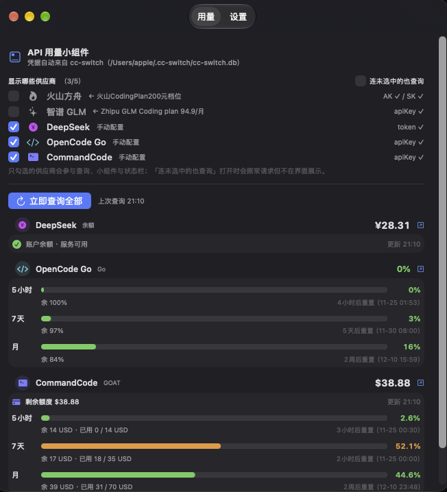
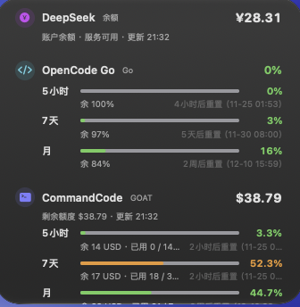
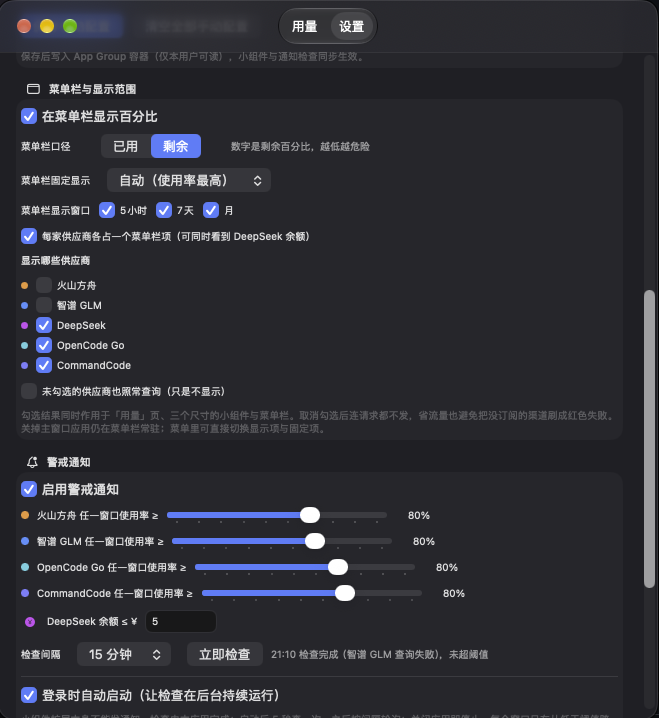
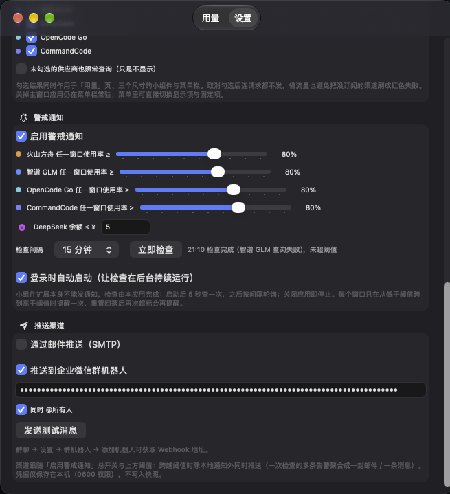
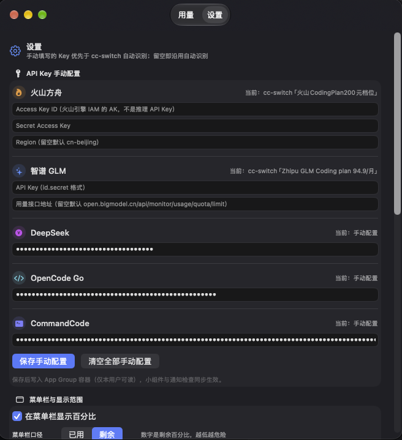

# QuotaBar · AI 订阅额度监视器

[English](README.en.md) · **简体中文**

> macOS 菜单栏 + 桌面小组件 + Windows 命令行，一眼看清你所有 AI 编程订阅还剩多少。



把火山方舟、智谱 GLM、DeepSeek、OpenCode Go、CommandCode 的额度集中到一个地方：菜单栏常驻数字、桌面小组件、超额警戒通知。凭据自动复用 [cc-switch](https://github.com/farion1231/cc-switch)，零配置。

**零第三方依赖**：Swift 端只用系统框架（SwiftUI / AppKit / WidgetKit / CryptoKit / SQLite3），Windows 端只用 Python 标准库。

---

## 支持的供应商

| 供应商 | 指标 | 查询方式 |
|---|---|---|
| **火山方舟** Coding Plan | 5小时 / 7天 / 月 三窗口使用率、剩余额度、重置时间 | OpenAPI V4 签名（AK/SK），`GetCodingPlanUsage` 失败回落 `GetAFPUsage` |
| **智谱 GLM** Coding Plan | 5小时 / 7天 双窗口，剩余积分、已用/总量、重置时间 | `GET /api/monitor/usage/quota/limit`，裸 apiKey 鉴权 |
| **DeepSeek** | 账户余额（CNY）+ 服务可用状态 | `GET /user/balance` |
| **OpenCode Go** | 5小时 / 7天 / 月 三窗口使用率与重置时间 | `GET opencode.ai/zen/go/v1/usage`，Bearer sk- 鉴权 |
| **CommandCode**（GOAT / Pro / Max…） | 5小时 / 周 / 月 使用率 + credits 余额（USD） | 官方 CLI 的 `/alpha` 私有路由 |

### 关于 CommandCode 的月度口径

`billing/credits` 返回的是**剩余**池，不是总额。所以月度使用率按 `已花 ÷ (已花 + 剩余)` 计算 —— 实测 GOAT 周期内 30.90 已花 + 39.35 剩余 = 70.25 总额。

若直接把剩余当总额（`已花 ÷ 剩余`），百分比会在周期后段严重高估：同样的数据会把 44% 算成 78%。

---

## 三种界面

### 菜单栏（状态栏）

常驻菜单栏，图标 + 用量数值，按使用率上色（<50% 绿 / ≥50% 橙 / ≥80% 红）。


上图是「显示剩余额度」模式：每家一个菜单栏项，依次是 CommandCode、OpenCode Go 与 DeepSeek 余额。

- **每家单独一个菜单栏项**（默认）：DeepSeek 余额 `¥28.31`、OpenCode Go `5h 1% 周 3% 月 16%`、CommandCode `5h 0.2% 周 51% 月 44%` 可同时看到
- 或合并为一项，自动显示使用率最高的那家
- 点开菜单：每家明细（所有窗口 + 余额 + 重置倒计时）、切换显示项、立即刷新、直达控制台
- 关掉主窗口应用不退出，菜单栏继续常驻

### 桌面小组件

三种尺寸（小 / 中 / 大），数据由系统按 ~15 分钟预算自动刷新，每种尺寸都带 ↻ 手动刷新按钮。

<p>

</p>

上图是大号小组件：每家供应商一张卡片，纵向排开，余额与各窗口进度一目了然。卡片点击跳对应控制台。

### 超额警戒

火山 / 智谱 / OpenCode Go / CommandCode 任一窗口使用率超阈值，或 DeepSeek 余额低于阈值时发本地通知。可同时推送到**邮件（SMTP）**或**企业微信群机器人**。每个窗口只在「从低于阈值跨到高于阈值」时提醒一次，不会刷屏。

---

## 只显示你订阅的那几家

没订阅的渠道不必出现在界面上：

- 「用量」页每个供应商前有复选框，设置页也能改（两处同步）
- 勾选结果同时作用于卡片、三个尺寸的小组件、警戒通知、菜单栏
- 默认**未勾选就不发请求** —— 省流量，也避免把没订阅的渠道刷成一片红色失败；想留数据但不展示时，打开「未勾选的供应商也照常查询」
- 全部取消勾选等价于「全部显示」，不会出现空态
- 菜单栏还能单独选「显示哪些窗口」（5小时 / 7天 / 月 任选）

| 显示范围与菜单栏口径 | 警戒阈值与推送渠道 |
|---|---|
|  |  |

---

## 工作原理

```
容器 App（未沙箱）
  ├─ 读 ~/.cc-switch/cc-switch.db（只读 SQLite）
  │    按 meta.usage_script 识别凭据；OpenCode 的 key_env 只存变量名，
  │    真值从 ~/.hermes/.env 等 dotenv 文件解析
  └─ 导出到 App Group 容器 credentials.json（0600）并触发小组件刷新

小组件扩展（沙箱 + network.client + App Group）
  ├─ 读 App Group 容器里的 credentials.json
  ├─ 并发查询各家接口（CryptoKit 做火山 V4 签名）
  ├─ 写缓存 snapshot.json（App 启动时也读它）
  └─ 渲染；网络失败时显示缓存值并标注

菜单栏（App 进程内 NSStatusItem）
  └─ 读同一份快照渲染，点「立即刷新」才发网络请求
```

**小组件必须沙箱**：macOS 的插件注册（pkd）拒绝收录未沙箱的 appex，所以 widget 通过 App Group 与未沙箱的 App 交换数据。

凭据**只留在本机**（App Group 容器，0600 权限），不写日志、不进快照文件。

---

## 安装

### 从源码构建（macOS）

```bash
# 终端自检：不依赖 Xcode 工程，直接验证凭据与解析
swiftc -O Shared/Models.swift Shared/ProvidersStore.swift Shared/QueryService.swift \
       Shared/SnapshotCache.swift scripts/UsageCheck.swift -o build/usagecheck && ./build/usagecheck

# 构建 App + Widget Extension
DEVELOPER_DIR=/Applications/Xcode.app/Contents/Developer \
  xcodebuild -project ApiUsageShow.xcodeproj -target ApiUsageShow \
  -configuration Release SYMROOT="$PWD/build" OBJROOT="$PWD/build/obj" build

# 安装并注册
cp -R build/Release/ApiUsageShow.app /Applications/
open /Applications/ApiUsageShow.app
/System/Library/Frameworks/CoreServices.framework/Frameworks/LaunchServices.framework/Support/lsregister -f /Applications/ApiUsageShow.app
```

添加小组件：桌面或通知中心右键 →「编辑」→ 搜索「API 用量」。

### 签名（必读，否则小组件加不上）

macOS 26 上要让小组件出现在小组件库，必须同时满足两点：

1. **开发者证书签名**（ad-hoc `-` 不行）：Xcode → Settings → Accounts 登录 Apple ID（免费个人团队即可）→ Manage Certificates 生成 Apple Development 证书。工程里 `DEVELOPMENT_TEAM` 要填证书的**真实 Team ID**（`security find-certificate -c "Apple Development" -p | openssl x509 -noout -subject` 里的 `OU=`），而不是证书名称括号里的账号标识 —— 两者可能不同，填错会报 `No signing certificate "Mac Development" found`。
2. **widget 扩展必须开启 App Sandbox**：`Widget/ApiUsageShowWidget.entitlements` 声明 `app-sandbox` + `network.client` + `application-groups`；App 只带 `application-groups`（保持未沙箱以读取 cc-switch 数据库）。

**换成你自己的 Team ID**：本仓库不附带可用的签名身份，你需要替换三处 —— `project.pbxproj` 里的 `DEVELOPMENT_TEAM`、两个 `.entitlements` 里的 App Group ID、以及 `Shared/SnapshotCache.swift` 里 `AppGroup.identifier` 的前缀。App Group ID 必须以自己的 Team ID 为前缀。

验证扩展被系统收录：`pluginkit -m -v -i com.apiusage.show.widget`

### Windows / WSL（命令行）

Python 3.10+，纯标准库，零依赖：

```bat
python windows\api_usage.py                  :: 查询一次
python windows\api_usage.py --watch 300      :: 每 5 分钟刷新 + 越线发 Windows 通知
python windows\api_usage.py --json           :: 输出 JSON
python windows\api_usage.py --list           :: 只看识别到的凭据（脱敏）
```

详见 [windows/README-WINDOWS.md](windows/README-WINDOWS.md)。菜单栏与小组件为 macOS 专属，Windows 版是能力等价的命令行工具。

---

## 凭据从哪来

**首选：cc-switch 自动识别。** 你在 cc-switch 里怎么配的，这里就怎么用，改完 key 重新打开一次 App 即可同步：

| 供应商 | cc-switch 里的来源 |
|---|---|
| 火山方舟 | `usage_script.accessKeyId` / `secretAccessKey`（region 从 `ANTHROPIC_BASE_URL` 推导） |
| 智谱 GLM | `usage_script.apiKey` / `baseUrl` |
| DeepSeek | `env.ANTHROPIC_AUTH_TOKEN`（base URL 含 `api.deepseek.com`） |
| OpenCode Go | `api_key` → `key_env` → `options.apiKey`（`key_env` 只存变量名，真值从 dotenv 解析） |
| CommandCode | `api_key`，且 `usage_script.codingPlanProvider == "command_code"` |

**备选：App 设置页手动填写。** 手动配置优先于自动识别，写入同一 App Group 容器。适合 cc-switch 里没配、或想单独用另一把 key 的情况。



每家会显示当前生效的来源（cc-switch 的哪个 provider，或「手动配置」），留空就沿用自动识别。

---

## 项目结构

```
ApiUsageShow.xcodeproj/   手写工程：App + Widget Extension 两个 target
App/                      ApiUsageShowApp(TabView + AppDelegate), StatusView(用量 + 供应商勾选),
                          SettingsView(手动 Key + 显示范围 + 警戒 + 推送),
                          StatusBarController(菜单栏项与菜单), QuotaAlertCenter(定时检查),
                          PushChannels(邮件 / 企业微信)
Widget/                   时间线、RefreshUsageIntent（交互式刷新按钮）、三种尺寸视图
Shared/                   Models(+DotEnv), ProvidersStore(cc-switch 识别), QueryService(五厂商),
                          DisplayPreferences(显示偏好), SnapshotCache, ViewHelpers
scripts/                  UsageCheck.swift(终端自检), make_icons.swift(图标生成)
windows/                  Windows 命令行版（Python 单文件，能力等价）
```

---

## 免责声明

本项目使用的接口中，**有一部分并非官方公开 API**：

- **智谱 / 火山**：镜像 cc-switch 的实现，字段口径来自实测
- **CommandCode**：`/alpha/*` 是官方 CLI 内部使用、未公开文档化的账户路由
- **OpenCode Go**：`zen/go/v1/usage` 为实测端点

这些接口随时可能改名、改字段或加校验，届时会查询失败（面板会直接显示原因，而不是静默出错）。本项目与上述任何厂商均无关联，仅供个人查看自己的订阅用量。请勿用于绕过配额限制或任何违反服务条款的用途。

## License

[MIT](LICENSE)
